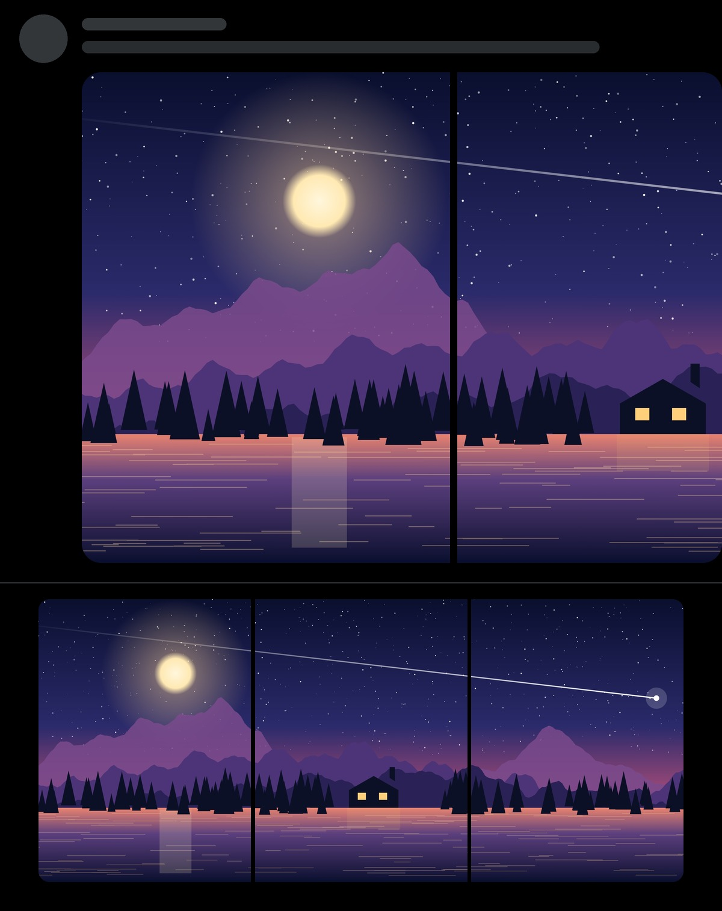
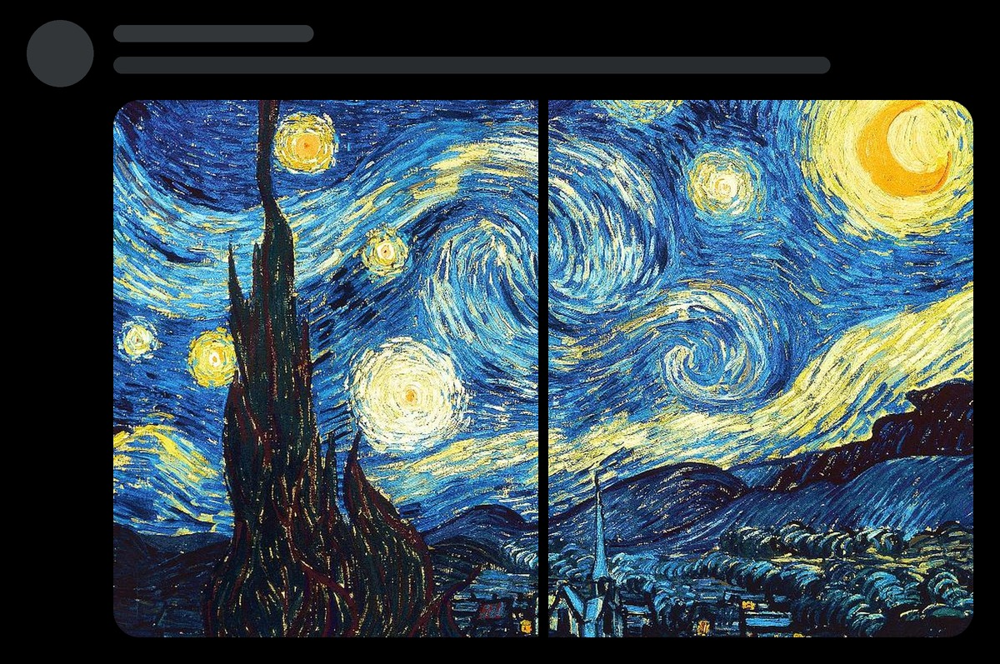
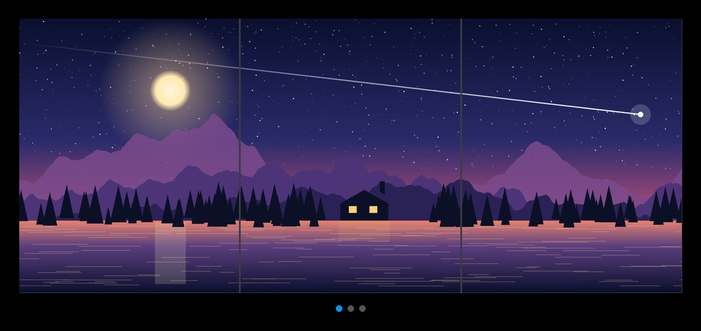

# Split for X

A Claude skill that splits one drawing or photo into panels that line up seamlessly when you post them together on X (Twitter) or in an Instagram carousel. Claude looks at the image, keeps the cuts away from faces and text, picks the strongest first panel, and shows you a mockup before you post.



| 2 images on X | Instagram carousel |
|---|---|
|  |  |

## Why

X now shows 3+ images as a swipe carousel and 2 images side by side, with a small gap between them. Cut an image in equal parts and the lines jump at every seam, or the cut lands right through a face. This skill measures that layout, drops a matching sliver at each seam so lines continue as if seen through a window, and lets Claude choose where the seams go.

## Use it

Send Claude an image and say *"split this for X"*, *"make a seamless carousel"* or *"post this drawing across 3 images"*. You get:
- the panels, numbered in upload order,
- a mockup of the post,
- one short alt text per panel.

## Install

**Claude app (claude.ai, desktop, mobile):** download [`split-for-x-skill.zip`](split-for-x-skill.zip) and upload it in your skills settings. Code execution must be on.

**Claude Code:**

```bash
git clone https://github.com/thibaud360/split-for-x
cp -r split-for-x/skills/split-for-x ~/.claude/skills/
```

**No install, just a prompt:** copy [`PROMPT.md`](PROMPT.md) into Claude with your image.

## Notes

- X layout measured on desktop in November 2026. If lines look slightly off in the phone app, ask Claude to re-run with no gap compensation.
- Examples: *The Starry Night*, Vincent van Gogh (1889, public domain), and an original illustration.
- Requires Python 3 with `pillow` and `numpy`.

## License

MIT
